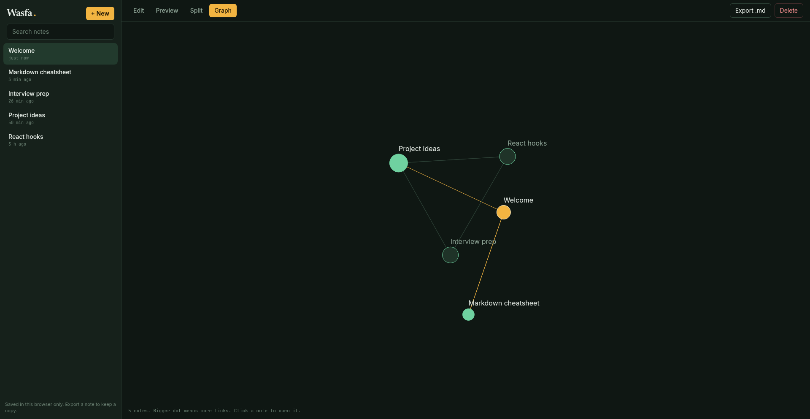

# Wasfa

A Markdown notebook where notes link to each other.

**Live demo:** https://malakmo7amed309.github.io/wasfa/



## Standout feature

Type `[[Note title]]` to link notes. Links render amber, and a red link means the note does not exist yet: click it and it is created. Every note lists its **backlinks**, and the **Graph** tab lays out all notes with a small force simulation (`src/graph.js`) so you can see how your ideas connect. Click a node to open it.

## Also included

- Own Markdown renderer (`src/md.js`): headings, lists, task lists, quotes, code blocks, links, images. HTML is escaped first.
- Tick task-list boxes in the preview and the Markdown source updates.
- Edit, preview, split and graph views. Search. Export a note as `.md`.
- Notes are saved in your browser (localStorage). There is no server, so nothing syncs between devices.

## Stack

Preact, Vite, Tailwind CSS 4. Fonts: Newsreader, Inter, JetBrains Mono.

## Develop

```
npm install
npm run dev
npm run build
```

The single-file build is in `docs/` and is served by GitHub Pages.
